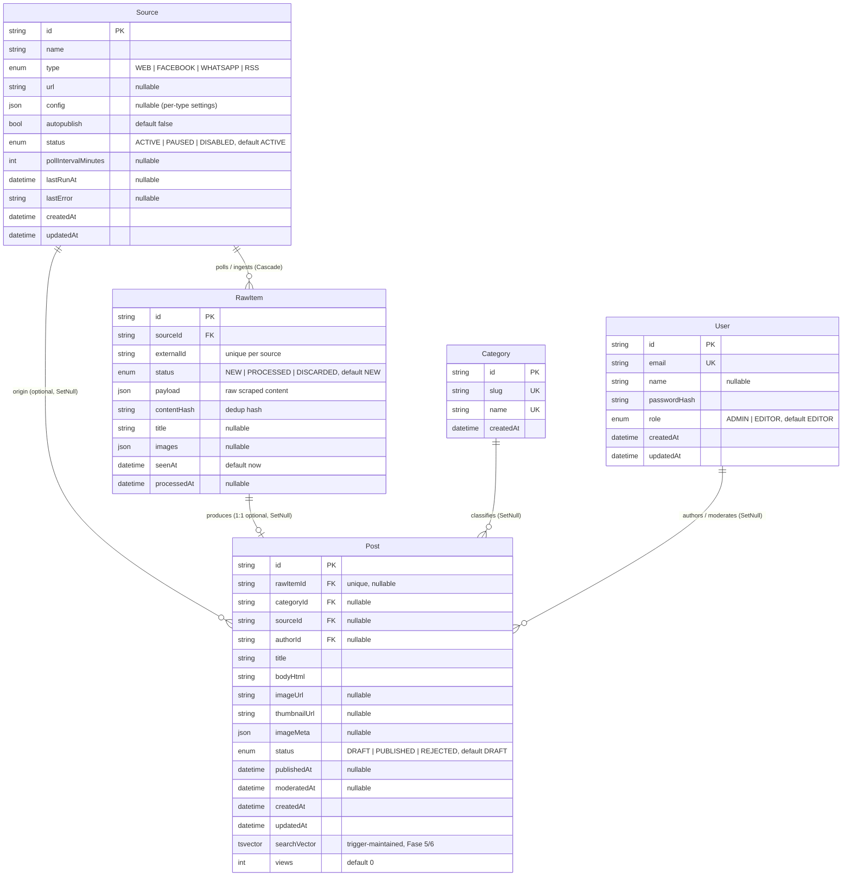

# Modelo Entidad-Relación — Base de datos UNJBG_News

Fuente: `prisma/schema.prisma` + migraciones SQL en `prisma/migrations/`
(Fase 5 y 6 agregan objetos que Prisma no expresa: `tsvector`, triggers, índices GIN).

Diagrama Mermaid listo para compilar en <https://mermaid.live> (también en `er-model.mmd`):

## Relaciones y cardinalidad

| Relación | Cardinalidad | Ubicación del FK | On delete |
|---|---|---|---|
| Source → RawItem | 1 : 0..* | `RawItem.sourceId` (requerido) | **Cascade** — borrar un source borra sus raw items |
| Source → Post | 1 : 0..* | `Post.sourceId` (opcional) | SetNull |
| RawItem → Post | 1 : 0..1 (1:1 efectivo) | `Post.rawItemId` (`@unique`) | SetNull |
| Category → Post | 1 : 0..* | `Post.categoryId` (opcional) | SetNull |
| User → Post | 1 : 0..* | `Post.authorId` (opcional) | SetNull |

No hay relaciones muchos-a-muchos ni tablas intermedias: el modelo es una estrella
con `Post` en el centro y `Source` alimentando dos ramas (`RawItem` y `Post` directo).

## Restricciones e índices

- `Source`: unique `(name, type)`
- `RawItem`: unique `(sourceId, externalId)` (dedup por source); índice `(status, seenAt)` para la cola de ingesta
- `Post` índices: `(status, publishedAt)`, `(status, views)`, `(categoryId)`, `(title)`
- `Category`: únicos `slug` y `name` — `User`: único `email`

## Objetos de base de datos no visibles en Prisma

- `Post.searchVector` es un `tsvector` mantenido por un trigger `BEFORE INSERT OR UPDATE`
  (`post_search_vector_update`): `title` con peso **A** + `bodyHtml` con peso **B**,
  usando configuración `spanish`. Prisma lo expone como `Unsupported("tsvector")`.
- Índices GIN: `Post_searchVector_idx` (full-text) y `Post_title_trgm_idx` (trigram,
  para búsqueda difusa). Requieren la extensión `pg_trgm`.
- `Post.views` fue agregado en Fase 6 con SQL crudo (`Int @default(0)`).

## Flujo de ingesta (cómo se conectan las entidades)

`Source` (poll) → `RawItem` (`status: NEW`) → procesado → `Post` (`status: DRAFT`)
→ moderado por un `User` → `PUBLISHED` (con `publishedAt` y contador `views`).
Un source puede publicar directo a `Post` si `autopublish` está activado.
